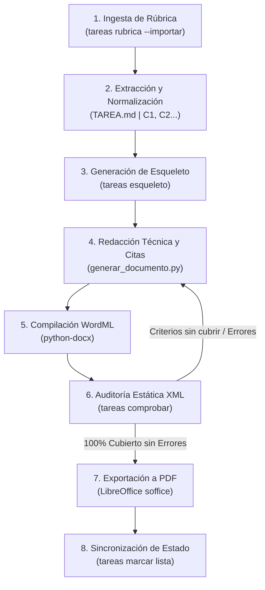

# Visión General y Patrones de Arquitectura

Este documento describe la arquitectura del sistema **document_generator**, el paradigma rector de desarrollo documental guiado por rúbricas (**rubric-driven**) y los patrones técnicos que gobiernan su ciclo de vida.

---

## 1. El Paradigma Rubric-Driven

En la educación superior técnica y en la ingeniería de software, los criterios de evaluación de un trabajo formal son definidos explícitamente por el cuerpo docente mediante rúbricas analíticas o matrices holísticas. Tradicionalmente, la redacción se realiza de forma libre y se intenta verificar la cobertura de los criterios de manera posterior, generando inconsistencias, desbalances de contenido y omisiones accidentales.

El enfoque **rubric-driven** invierte este flujo:

```
[Rúbrica Oficial (DOCX/PDF)]
            │
            ▼
[Ficha Estructurada TAREA.md]
            │
            ▼
[Esqueleto Ponderado por Pesos]
            │
            ▼
[Redacción de Secciones con Marcadores XML]
            │
            ▼
[Auditoría Estática Automática sobre el DOCX]
            │
       ┌────┴────┐
    [Falla]   [Aprobado]
       │         │
  (Corrección)   ▼
             [PDF Final Validado]
```

### Invariantes del Paradigma:
1. **Prioridad Absoluta de la Rúbrica:** Ninguna sección de desarrollo se redacta sin un identificador de criterio explícito (`C1`, `C2`, etc.) asociado a un peso porcentual o de puntaje.
2. **Ponderación Proporcional:** La extensión orientativa de palabras de cada sección es una función directa del peso porcentual de su criterio sobre el total del documento.
3. **Validación sobre el Artefacto Compilado:** La comprobación de cobertura no analiza el script generador (`generar_documento.py`) ni confía en declaraciones de texto; audita directamente la estructura OpenXML del archivo `.docx` resultante.

---

## 2. Pipeline de Procesamiento Documental

El ciclo de vida completo de un entregable académico se estructura en cinco etapas secuenciales:



### Descripción de Etapas:

1. **Ingesta de Rúbrica:** El comando `tareas rubrica <tarea> --importar <archivo.docx>` extrae tablas docentes nativas, detecta cabeceras, identifica puntajes numéricos y asigna IDs canónicos (`C1`, `C2`, ...).
2. **Normalización:** La ficha `TAREA.md` consolida la rúbrica en formato tabular Markdown estándar con cuatro columnas canónicas: `ID`, `Criterio`, `Puntaje`, `Dónde se cumple`.
3. **Esqueleto Ponderado:** `tareas esqueleto` calcula la cuota teórica de palabras para cada sección en función de la longitud objetivo y genera llamadas estructuradas (`titulo(...)` o `titulo_seccion(...)`) con los parámetros de criterio correspondientes.
4. **Redacción Técnica:** Los integrantes del equipo o el agente desarrollan el contenido sustentado en fuentes validadas, insertando citas automáticas y tablas estructuradas.
5. **Compilación WordML:** El script genera el paquete `.docx` (formato ZIP con esquema de partes XML estándar).
6. **Auditoría Estática:** `tareas comprobar` descomprime en memoria el `.docx`, examina el árbol XML del cuerpo (`w:document -> w:body`), extrae estilos de párrafo (`w:pStyle`), marcadores (`w:bookmarkStart`) y cuenta palabras netas por sección.
7. **Exportación a PDF:** Si y solo si la auditoría no arroja errores bloqueantes, se invoca a LibreOffice en modo *headless* con aislamiento de grupo de proceso para compilar el PDF definitivo.
8. **Sincronización:** Se actualiza la tabla de control en el `MATERIA.md` de la materia y el estado de la tarea pasa a `lista`.

---

## 3. Arquitectura de Módulos del Sistema

El software está desacoplado en componentes con responsabilidades bien delimitadas dentro del paquete `plantillas`:

| Módulo / Paquete | Responsabilidad | Interfaz Pública Principal |
|---|---|---|
| `tareas.py` | Despachador CLI ligero y registro de subcomandos. | `main()`, entrypoint `tareas` |
| `cli/comandos_gestion.py` | Controladores de ciclo de vida del repositorio. | `cmd_verificar()`, `cmd_materia()`, `cmd_tarea()`, `cmd_marcar()` |
| `cli/comandos_documentales.py` | Controladores del pipeline de generación, compilación Markdown y rúbricas. | `cmd_rubrica()`, `cmd_esqueleto()`, `cmd_generar()`, `cmd_compilar()`, `cmd_comprobar()`, `cmd_auditar()` |
| `cli/comandos_temas.py` | Controladores de gestión de temas documentales, vistas previas y catálogo de estilos. | `cmd_temas()`, `cmd_estilos()` |
| `cli/servicio_pdf.py` | Aislamiento de procesos LibreOffice headless y conversión. | `convertir_a_pdf()`, `localizar_soffice()` |
| `cli/tablas.py` | Visualización tabular y estado agregado de tareas. | `cmd_estado()` |
| `motor_base.py` | Protocolo base abstracto y catálogo de motores documentales. | `BaseDocumentEngine`, `registrar_motor()`, `obtener_motor()`, `marcar_elemento()` |
| `apa_docx.py` | Motor de maquetación bajo el estándar formal APA 7 (`MotorAPA7`) y citación multi-estilo. | `nuevo_documento()`, `Bibliografia` |
| `formato_institucional.py` | Motor configurable por temas JSON (`MotorInstitucional`). | `nuevo_documento_tematico()`, `titulo_seccion()`, `marcar_transversal()` |
| `markdown_docx.py` | Compilador declarativo de Markdown + YAML frontmatter hacia WordML (`.docx`). | `compilar_markdown()`, `extraer_frontmatter()` |
| `temas.py` / `extractor_tema.py` | Preset base `apa7`, carga JSON (`themes/` y `themes/local/`) y extracción automática desde `.docx`. | `cargar_tema()`, `listar_temas()`, `extraer_tema_desde_docx()` |
| `preview_tema.py` | Generación de vistas previas de temas y catálogo visual comparativo de estilos. | `generar_preview_tema()`, `generar_catalogo_estilos()`, `obtener_catalogo_estilos()` |
| `omml.py` / `bloques.py` | Ecuaciones matemáticas OMML vectoriales y componentes editoriales universales. | `formula_bloque()`, `parrafo_estructurado()`, `enunciado_formal()`, `tabla_academica()` |
| `rubrica.py` | Extracción de rúbricas desde DOCX, normalización y cálculo de pesos. | `leer()`, `importar_docx()`, `escribir()` |
| `esqueleto.py` | Generación de plantillas de código ponderadas según rúbrica. | `generar_esqueleto()` |
| `comprobar.py` | Motor de auditoría estática sobre WordML y agregación global. | `analizar()`, `comprobar()`, `auditar_todo()` |
| `ficha.py` | Parseo bidireccional y actualización de `TAREA.md` y `MATERIA.md`. | `leer_tarea()`, `actualizar_tarea()` |
| `config.py` | Lectura segura, tipado y validación de variables en `.env`. | `cargar()`, `cargar_o_salir()` |
| `fuentes_comunes.py` | Catálogo canónico de fuentes pre-validadas en APA 7. | `FUENTES_CARRERA`, `cargar_en_bibliografia()` |

---

## 4. Patrón de Detección de Criterios (Invisible Bookmarks)

Para vincular una sección del documento con un criterio de la rúbrica sin alterar la estética visual ni requerir texto artificial visible para el docente, el sistema utiliza el estándar de marcadores nativos de OpenXML (`w:bookmarkStart` y `w:bookmarkEnd`):

```xml
<w:p>
  <w:pPr>
    <w:pStyle w:val="Heading1"/>
  </w:pPr>
  <!-- Marcador de auditoría estática invisible en la impresión -->
  <w:bookmarkStart w:id="1" w:name="rubrica_C1"/>
  <w:r>
    <w:t>1. Marco Teórico de la Lógica Proposicional</w:t>
  </w:r>
  <w:bookmarkEnd w:id="1"/>
</w:p>
```

Para criterios transversales (como redacción, ortografía, formato o trabajo grupal que aplican a la totalidad del informe), se inyecta el sufijo `_todo` (`rubrica_C5_todo`). El motor de auditoría reconoce este marcador en cualquier sección del cuerpo e indexa el criterio como satisfecho en todo el documento.
