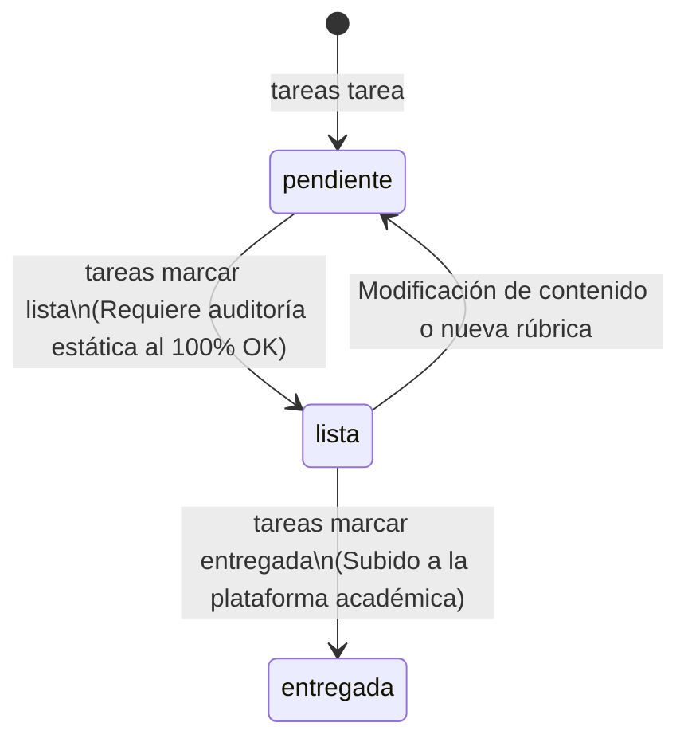

# Modelo de Datos y Fichas de Control

Este documento detalla la estructura formal de los archivos de metadatos del sistema, las convenciones de las fichas de tarea (`TAREA.md`), la ficha de materia (`MATERIA.md`) y el modelo de estados de entrega.

---

## 1. Estructura Canónica de Directorio de una Tarea

Cada tarea dentro de `materias/<materia>/<CODIGO>_<Titulo>/` se organiza bajo una estructura fija de subdirectorios e insumos:

```
materias/<materia>/<CODIGO>_<Titulo>/
├── TAREA.md                     # Ficha técnica con metadatos y tabla de rúbrica
├── enunciado/                   # Archivos oficiales del docente (PDF, DOCX)
├── capturas/                    # Capturas de pantalla y evidencias de ejecución real
├── insumos/                     # Borradores, apuntes de clase y aportes grupales
├── generar_documento.py         # Script generador y maquetador del documento
└── <CODIGO>_<Titulo>_<SUFIJO>.docx / .pdf  # Entregables finales compilados
```

---

## 2. Esquema de Ficha de Tarea (`TAREA.md`)

Cada carpeta de tarea contiene de manera obligatoria una ficha `TAREA.md` estructurada en formato Markdown. Esta ficha actúa como la única fuente de verdad (*single source of truth*) para los metadatos de la tarea, su estado y su rúbrica.

### Estructura Canónica:

```markdown
# <CODIGO> — <Titulo Corto de la Tarea>

- **Materia:** <Nombre Oficial de la Materia>
- **Tipo:** <Actividad (A) | Práctica (P) | Evaluación (E) | Seminario (S)>
- **Modalidad:** <Individual | Grupal>
- **Grupo:** <Nombre o número del grupo, p. ej. Grupo 1 (si aplica)>
- **Integrantes:** <Lista de estudiantes separados por comas (si aplica)>
- **Docente:** <Nombre y Título del Docente>
- **Fecha de entrega:** <YYYY-MM-DD o Indicación de Cronograma>
- **Extensión:** <P. ej. 1500 palabras o 4-6 páginas>
- **Estado:** <pendiente | lista | entregada>
- **Archivo entregable:** <nombre_archivo.docx> / <nombre_archivo.pdf>

## Enunciado

<Descripción o enlace al documento oficial en enunciado/>

## Rúbrica

| ID | Criterio | Puntaje | Dónde se cumple |
|---|---|---|---|
| C1 | <Descripción exacta del criterio 1> | <Peso numérico o porcentaje> | <Rellenado automáticamente> |
| C2 | <Descripción exacta del criterio 2> | <Peso numérico o porcentaje> | <Rellenado automáticamente> |

## Qué se entrega

- [x] Informe .docx (`<nombre>.docx`)
- [x] Informe .pdf (`<nombre>.pdf`)

## Formato

<APA 7, academico, tecnico, ejecutivo, ieee o nombre de tema local en themes/local/>
```

### Campos de Cabecera:

| Campo | Tipo | Obligatorio | Descripción |
|---|---|---|---|
| `Materia` | String | Sí | Nombre de la asignatura; si se omite, se hereda de `MATERIA.md`. |
| `Tipo` | Enum | Sí | Clasificación de la tarea: Actividad (A), Práctica (P), Evaluación (E), Seminario (S). |
| `Modalidad` | Enum | No | Régimen de trabajo: `Individual` o `Grupal`. Si se omite, se deduce del campo `Grupo` o integrantes. |
| `Grupo` | String | No | Denominación o número de equipo (ej. `Grupo 1`, `Equipo Beta`). |
| `Integrantes` | Str / List | No | Nombres de integrantes. Admite formato en línea (comas/puntos y coma) o sub-viñetas indentadas (`- Alumno`). |
| `Docente` | String | No | Nombre del profesor titular. Si no se especifica, se hereda de la materia. |
| `Fecha de entrega` | ISO Date / Str | Sí | Fecha límite en formato `YYYY-MM-DD` o referencia al cronograma del EVA. |
| `Extensión` | String | No | Longitud objetivo (`N palabras`, `N páginas`). Utilizada por `tareas comprobar` para advertir sobre documentos cortos. |
| `Estado` | Enum | Sí | `pendiente`, `lista` o `entregada`. |
| `Archivo entregable` | Path | Sí | Nombres esperados de los artefactos compilados `.docx` y `.pdf`. |

> [!NOTE]
> **Reglas de Detección y Precedencia de Autoría:**
> 1. Si `Modalidad` se declara explícitamente como `Individual`, la tarea se procesa estrictamente como individual ignorando placeholders de grupo (`N/A`, `ninguno`, `-`).
> 2. El parser de `plantillas/ficha.py` soporta sub-viñetas indentadas bajo `- **Integrantes:**`, extrayendo la lista estructurada de forma automática.
> 3. Si una tarea es grupal y no detalla integrantes en la ficha, recurre en cascada a `INTEGRANTES_DEFECTO` del `.env` local.

---

## 3. La Tabla de Rúbrica Canónica

La sección `## Rúbrica` de `TAREA.md` define los criterios de evaluación. Debe mantener rigurosamente las cuatro columnas siguientes:

```markdown
| ID | Criterio | Puntaje | Dónde se cumple |
|---|---|---|---|
| C1 | Comprensión de la sintaxis y operadores | 20 pts | 1. Identificar proposiciones (86 pal.) |
| C2 | Construcción manual de tablas de verdad | 20 pts | 2. Desarrollo de tablas de verdad (239 pal.) |
| C3 | Deducción formal mediante reglas de inferencia | 20 pts | 3. Deducción formal (106 pal.) |
| C4 | Aplicación en el contexto de IA/Ciberseguridad | 20 pts | 4. Aplicación SOC (320 pal.) |
| C5 | Trabajo grupal y creatividad | 20 pts | todo el documento |
```

### Reglas de Parseo y Normalización (`plantillas/rubrica.py`):
1. **Identificadores (`ID`):** Deben seguir el formato `C1`, `C2`, `C3`... Si la tabla no incluye columna `ID`, el parser genera automáticamente identificadores secuenciales basados en el orden de las filas.
2. **Puntajes y Porcentajes (`Puntaje`):** Se admiten valores enteros o decimales con coma o punto (`2,5 pts`, `20%`, `3.0`, `15 puntos`). El parser extrae el float correspondiente y calcula la cuota proporcional respecto al total de la rúbrica.
3. **Criterios Transversales:** Criterios cuyo texto incluya palabras clave como *ortografía*, *redacción*, *formato*, *presentación*, *creatividad* o *trabajo grupal* son clasificados automáticamente con `transversal = True`.
4. **Columna "Dónde se cumple":** Es actualizada automáticamente por `tareas generar` o `tareas comprobar --actualizar`, insertando el título del encabezado del documento Word que satisface el criterio, su recuento de palabras y conteo de tablas/figuras.

---

## 4. Ficha de Control de Materia (`materias/<materia>/MATERIA.md`)

Cada asignatura cuenta con su archivo `MATERIA.md` (con fallback de compatibilidad a `README.md`) que define las directrices del docente y consolida la tabla de avance de todas las tareas:

```markdown
# <Nombre de la Asignatura>

- **Docente:** <Nombre del Docente>
- **Plataforma:** <EVA / Moodle / Canvas>
- **Formato:** <APA 7 / academico / tecnico / ejecutivo / ieee / tema-local>
- **Reglas del docente:** <Restricciones específicas de formato o entrega>

## Tareas

| Tarea | Entrega | Estado | Dónde se entrega |
|---|---|---|---|
| [CP1 — Clase Práctica 1](CP1_Clase_Practica_1_Logica_Proposicional/TAREA.md) | 2026-10-25 | lista | EVA (Buzón Tareas) |
| [TP1 — Tarea Práctica 1](TP1_Tarea_Practica_1_Logica_Proposicional/TAREA.md) | 2026-10-28 | lista | EVA (Buzón Tareas) |
```

---

## 5. Máquina de Estados de una Tarea

El ciclo de estados de un entregable está formalizado y protegido contra cambios inconsistentes:



> [!IMPORTANT]
> El subcomando `tareas marcar <tarea> lista` valida previamente la auditoría estática. Si existen criterios sin cubrir o errores de citas pendientes, el comando rechaza la transición de estado a menos que se fuerce explícitamente con la bandera `--forzar`.
