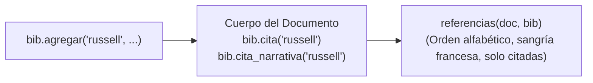

# Motor Documental APA 7 (`plantillas.apa_docx`)

El módulo `plantillas.apa_docx` proporciona una API en Python para la composición automatizada de documentos técnicos y académicos rigurosamente apegados a las normas **APA 7 (7.ª edición)** para trabajos de estudiantes universitarios.

---

## 1. Especificación Tipográfica y Geométrica

El documento generado mediante `nuevo_documento()` configura los parámetros del estándar APA 7 a nivel de propiedades de sección y estilos predeterminados de WordML:

| Parámetro | Valor APA 7 | Implementación en `apa_docx.py` |
|---|---|---|
| Tamaño de Papel | US Letter (8.5" × 11") | `sec.page_width = Inches(8.5)`, `sec.page_height = Inches(11.0)` |
| Tipografía del Cuerpo | Times New Roman | `Normal.font.name = "Times New Roman"` (`w:rFonts` en los 4 alfabetos) |
| Tamaño de Fuente | 12 pt | `Normal.font.size = Pt(12)` |
| Color del Texto | Automático / Monocromático | `Normal.font.color.rgb = RGBColor(0, 0, 0)` |
| Interlineado | Doble (2.0) | `Normal.paragraph_format.line_spacing = 2.0` |
| Espaciado entre Párrafos | 0 pt antes, 0 pt después | `space_before = Pt(0)`, `space_after = Pt(0)`, `widow_control = True` |
| Sangría de Primera Línea | 0.5 pulgadas (1.27 cm) | `first_line_indent = Inches(0.5)` |
| Márgenes de Página | 1 pulgada (2.54 cm) en los 4 lados | `top_margin = Inches(1.0)`, `header_distance = Inches(0.5)` |
| Numeración de Página | Esquina superior derecha continua | Campo `PAGE` en encabezado derecho en Times New Roman 12 pt (`w:fldChar`) |

---

## 2. Niveles de Encabezados con Estilos Nativos de Word

APA 7 define cinco niveles jerárquicos de encabezados. `plantillas.apa_docx` implementa los niveles principales utilizando estilos nativos de Word (`Heading 1`, `Heading 2`, `Heading 3`), asegurando que aparezcan en el panel de navegación de Word y en la tabla de contenidos de los PDFs exportados:

| Nivel APA | Formato Visual en Word | Llamada de API |
|---|---|---|
| **Nivel 1** | Centrado, Negrita, Caso de Título | `titulo(doc, "Marco Teórico", 1, criterios="C1")` |
| **Nivel 2** | Alineado a la izquierda, Negrita | `titulo(doc, "Antecedentes del Problema", 2)` |
| **Nivel 3** | Alineado a la izquierda, Negrita, Cursiva | `titulo(doc, "Revisión de Algoritmos", 3)` |

### Firma de la Función `titulo`:

```python
def titulo(
    doc: Document,
    texto: str,
    nivel: int = 1,
    criterios: Optional[Union[str, List[str]]] = None
) -> Paragraph:
    """Inserta un encabezado con estilo Heading nativo y marcadores de rúbrica invisibles."""
```

El parámetro `criterios="C1"` (o lista `criterios=["C1", "C2"]`) inserta los marcadores XML `w:bookmarkStart` correspondientes para ser auditados por `tareas comprobar`.

---

## 3. Gestor Bibliográfico (`Bibliografia`)

La clase `Bibliografia` gestiona las fuentes académicas en estilo **APA 7** por defecto (`estilo="apa7"`), además de soportar **IEEE numérico** (`estilo="ieee"`, `[1]`) y **Vancouver** (`estilo="vancouver"`, `(1)`), previniendo citas huérfanas y normalizando la puntuación final para evitar doble punto (p. ej. tras `"4.a ed."`).



### 1. Registro de Fuentes:

```python
bib = Bibliografia()

# Libro con autores múltiples
bib.agregar(
    "russell_norvig",
    ["Russell, S.", "Norvig, P."],
    2021,
    "Artificial Intelligence: A Modern Approach",
    editorial="Pearson",
    edicion="4.ª ed."
)

# Artículo de revista o reporte institucional
bib.agregar(
    "nist_sp800",
    ["National Institute of Standards and Technology"],
    2012,
    "Computer Security Incident Handling Guide",
    informe="Special Publication 800-61 Rev. 2",
    doi="https://doi.org/10.6028/NIST.SP.800-61r2"
)
```

### 2. Citación en el Texto:

* **Cita Parentética:** `parrafo(doc, f"El razonamiento lógico es determinista {bib.cita('russell_norvig')}.")`  
  Produce: `El razonamiento lógico es determinista (Russell y Norvig, 2021).`
* **Cita Narrativa:** `parrafo(doc, f"De acuerdo con {bib.cita_narrativa('russell_norvig')}, la base de conocimiento...")`  
  Produce: `De acuerdo con Russell y Norvig (2021), la base de conocimiento...`

### 3. Generación de la Lista de Referencias:

```python
referencias(doc, bib, criterios="C4")
```

Propiedades automáticas de la lista de referencias:
* Comienza en una página nueva tras un salto de sección o página.
* Título centrado en negrita: `Referencias`.
* Ordenación alfabética estricta por primer apellido del autor principal.
* Sangría francesa (*hanging indent*) de 0.5 pulgadas.
* Solo incluye fuentes que hayan sido citadas en el texto (evitando referencias artificiales).
* Si se proporciona `criterios="C4"`, vincula el criterio de bibliografía de la rúbrica a esta sección.

---

## 4. Figuras y Tablas Académicas

El módulo incorpora generadores con numeración secuencial automática, título en cursiva y notas al pie:

### Figuras:
```python
figura(
    doc,
    ruta_imagen=AQUI / "capturas" / "topologia.png",
    titulo_figura="Diagrama de red del laboratorio SOC",
    nota="Elaboración propia mediante captura del simulador GNS3.",
    ancho_pulgadas=5.5
)
```

### Tablas:
```python
tabla(
    doc,
    encabezados=["Métrica", "Algoritmo A", "Algoritmo B"],
    filas=[
        ["Precisión", "98.4%", "91.2%"],
        ["Recall", "96.1%", "89.5%"],
        ["F1-Score", "97.2%", "90.3%"]
    ],
    titulo_tabla="Comparativa de rendimiento en detección de anomalías",
    nota="Datos obtenidos tras 50 épocas de entrenamiento en el dataset CICIDS2017."
)
```
Las tablas se maquetan con el estilo APA: bordes horizontales superior, de cabecera e inferior, sin bordes verticales divisorios.

---

## 5. Portada y Modalidad (Individual vs. Grupal)

La función `nuevo_documento()` soporta de forma nativa ambas modalidades de autoría universitaria:

* **Modalidad Individual:**
  - Extrae `NOMBRE_ESTUDIANTE` de `.env` o del parámetro `nombre`.
  - Si `Modalidad: Individual` se declara explícitamente, se anulan automáticamente placeholders como `Grupo: N/A` o residuos de grupo.
  - Compone la portada clásica APA 7 de estudiante: Título, Autor único, Afiliación, Curso, Docente y Fecha.
  - El entregable se nombra: `<base>_<SUFIJO_ARCHIVOS>.docx` (ej. `A15_Titulo_Perez_Ana.docx`).
* **Modalidad Grupal:**
  - Se activa si la tarea declara `Modalidad: Grupal` en `TAREA.md`, o si se especifican `grupo` o múltiples `integrantes`.
  - Compone la portada APA 7 para múltiples autores: Título, Nombre del Grupo (ej. `Grupo 1`), lista de integrantes completa, Afiliación institucional, Materia, Docente y Fecha.
  - El entregable se nombra: `<base>_<GRUPO>.docx` (ej. `CP1_Titulo_Grupo_1.docx`).
  - Las propiedades del documento WordML (`doc.core_properties.author`) registran a todos los integrantes para preservar la autoría académica en los metadatos.
