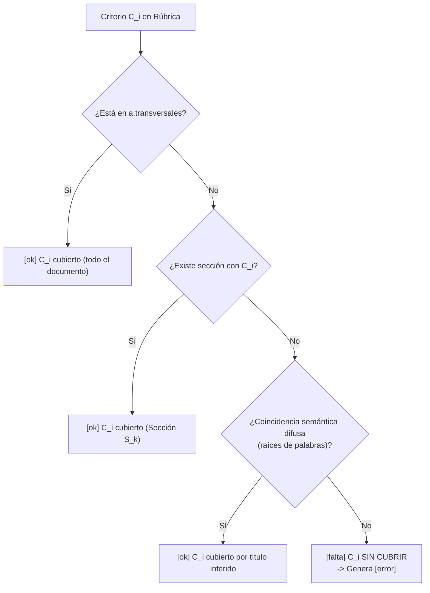

# Motor de Auditoría Estática (`plantillas.comprobar`)

El módulo `plantillas.comprobar` es el componente de aseguramiento de calidad del sistema. Realiza una inspección estática del árbol OpenXML del archivo `.docx` generado para certificar que cumple de forma verificable con la rúbrica docente antes de su entrega.

---

## 1. Inspección del Árbol OpenXML

A diferencia de validadores que leen texto plano o invocan aplicaciones de ofimática, `comprobar.py` analiza directamente la estructura XML empaquetada en el archivo ZIP del documento Word:

```
document.docx (ZIP Container)
  └── word/
      ├── document.xml          ← Árbol principal inspeccionado
      ├── styles.xml            ← Mapeo de styleId a nombres de estilo (Heading 1...)
      └── header1.xml / ...
```

### Algoritmo de Extracción (`analizar(ruta_docx)`):

1. **Resolución de Estilos:** Extrae el diccionario de estilos `{style_id: style_name}` desde `doc.styles`.
2. **Detección del Salto de Portada:** Identifica el primer párrafo que contenga un salto de página explícito (`w:br w:type="page"`). Todos los elementos previos son tratados como portada y excluidos del cómputo de palabras del cuerpo.
3. **Omisión de Índices (TOC):** Si detecta instrucciones de campo de tipo tabla de contenido (`w:instrText` con `TOC`), suspende el cómputo hasta el cierre del bloque.
4. **Procesamiento de Secciones y Encabezados:**
   - Detecta párrafos con estilos `Heading 1`, `Heading 2` o `Heading 3`.
   - Lee marcadores `w:bookmarkStart` presentes en el párrafo del encabezado.
   - Extrae el prefijo `rubrica_` y asigna los identificadores (`C1`, `C2`...) a la sección activa.
   - Si el marcador tiene el sufijo `_todo` (`rubrica_C5_todo`), se registra en el conjunto global de criterios transversales `a.transversales`.
5. **Cómputo Métrico por Sección:** Asocia cada párrafo y tabla posterior a la sección activa más profunda, acumulando:
   - Palabras netas (mediante tokenización por expresiones regulares `\w+(?:[-'’]\w+)*`).
   - Conteo de tablas (`w:tbl`).
   - Conteo de figuras (`w:drawing`).

---

## 2. Heurísticas y Reglas de Validación

### 1. Cobertura de Criterios de la Rúbrica:

Para cada criterio registrado en la tabla `## Rúbrica` de `TAREA.md`:



Si algún criterio no queda cubierto, el análisis concluye con código de error bloqueante (`exit code 1`).

---

### 2. Proporcionalidad y Balance de Contenido:

El sistema compara las palabras escritas en la sección que cubre el criterio contra su cuota teórica:

$$\text{Cuota Teórica} = \left( \frac{\text{Puntaje del Criterio}}{\text{Puntaje Total de Criterios no Transversales}} \right) \times \text{Palabras Totales del Cuerpo}$$

* **Alerta de Sección Poco Desarrollada (`[aviso]`):** Si una sección contiene menos del 40% de las palabras que le corresponden según su peso en puntos, se emite una advertencia de desarrollo insuficiente.
* **Alerta de Sección Desproporcionada (`[aviso]`):** Si una sección supera el doble (200%) de las palabras teóricas esperadas, se emite una advertencia de desbalance para evitar saturación de temas secundarios.

---

### 3. Detección de Contenido Pendiente:

Audita la presencia de marcadores de trabajo incompleto mediante el patrón de expresión regular:

```python
_PENDIENTE = re.compile(
    r"\[(?:FALTA|COMPLETAR|TODO|PENDIENTE)[^\]]*\]|\bFIXME\b|\bTODO:\b|\bPENDIENTE:\b|\blorem ipsum\b|(?-i:\bTODO\b)",
    re.I,
)
```

> [!NOTE]
> La expresión regular utiliza la bandera sensible a mayúsculas `(?-i:\bTODO\b)` para la palabra "TODO", evitando falsos positivos con el vocablo común en español *"todo"* (p. ej., *"todo el documento"*, *"lo es todo"*), pero detectando de forma infalible marcadores en mayúsculas como `TODO`, `TODO:`, `FIXME`, `[FALTA ...]` o fragmentos de texto falso (*lorem ipsum*).

---

### 4. Auditoría Biyectiva de Citas y Referencias (APA 7, IEEE y Vancouver):

* **Extracción de Citas en el Texto:** Escanea citas APA 7 narrativas (ej. `Fonseca (2016)`) y parentéticas (ej. `(Russell y Norvig, 2021; Epp, 2010)`), citas numéricas IEEE (`[1]`, `[2-3]`) y citas numéricas Vancouver (`(1)`, `(1,2)`), excluyendo indexación de código (`arr[0]`) o llamadas a funciones (`fn(1)`).
* **Extracción de Referencias:** Identifica la sección de título `Referencias` o `Bibliografía`, detecta automáticamente el estilo empleado (`[N] ...` para IEEE, `N. ...` para Vancouver o formato autor-año para APA 7) y parsea cada entrada bibliográfica.
* **Validación Cruzada:**
  - Si hay citas en el texto sin sección de Referencias $\rightarrow$ `[error]`.
  - Si una cita (autor-año o índice numérico) no encuentra su entrada correspondiente en la lista final $\rightarrow$ `[error]`.
  - Si una referencia bibliográfica no fue citada en ningún párrafo $\rightarrow$ `[aviso]`.

---

### 5. Auditoría de Integridad Tipográfica y Estética Editorial:

Durante el recorrido del árbol OpenXML en `analizar(ruta_docx)`, el motor inspecciona anomalías estructurales y estéticas que degradan la calidad de impresión y las reporta en `avisos_tipograficos` y `anomalias_formato`:

| Regla Auditada | Elemento OpenXML Inspeccionado | Condición de Alerta |
|---|---|---|
| **Estiramiento tipográfico en párrafos justificados** | `w:pPr/w:jc[@w:val="both"]` + `w:t` (`\n`) o `w:br` | Saltos de línea suaves dentro de un párrafo justificado. |
| **Fuga de sintaxis Markdown** | Texto plano concatenado de `w:t` | Presencia de asteriscos literales `**` sin convertir a runs nativos `w:b`. |
| **Cajas con barra lateral izquierda ("Estética IA")** | Tabla 1×1 (`w:tcBorders/w:left` o `w:tblBorders/w:left`) | Borde izquierdo grueso asimétrico (`w:sz >= 18` y `sz_left > sz_right * 2`). |
| **Párrafos con barra lateral izquierda ("Estética IA")** | Párrafo (`w:pPr/w:pBdr/w:left`) | Borde izquierdo grueso asimétrico (`w:sz >= 18` y `sz_left > sz_right * 2`). |
| **Fuga de comandos LaTeX crudos** | Texto de párrafos (`w:t`) y bloques matemáticos OMML (`m:t`) | Comandos LaTeX sin normalizar (`\forall`, `\text{}`, `\mathcal{}`, `\implies`, etc.) que generan `¿` en PDF; bloqueado como `[error]`. |
| **Pies de figura duplicados o doble punto** | Párrafos que inician con `Figura` (`w:t`) | Prefijo redundante (`Figura: Figura N.`) o cierre con doble punto (`..`); reportado en `avisos_tipograficos`. |
| **Duplicación en encabezados y pies de página** | `sec.header` y `sec.footer` (`w:instrText`, `w:drawing`) | Más de un campo `PAGE` o más de un elemento `w:drawing` en un mismo párrafo. |
