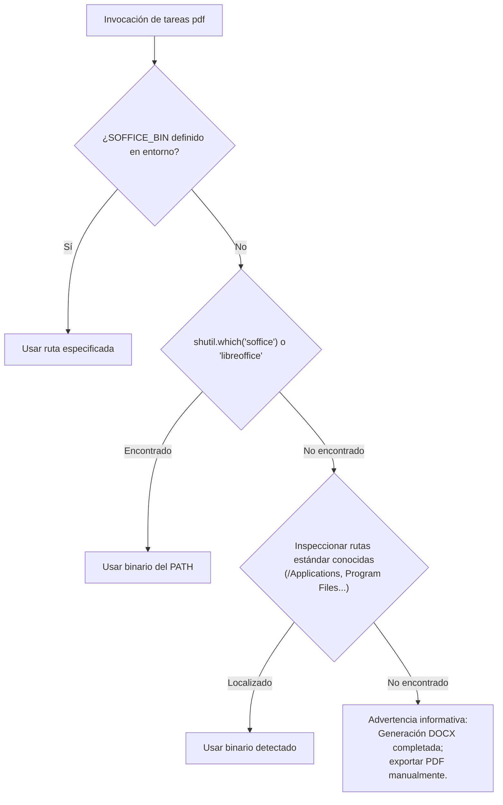

# Soporte Multiplataforma (Linux, macOS y Windows)

El repositorio está concebido bajo el principio de **paridad multiplataforma estricta**: cualquier desarrollador o estudiante debe poder clonar el repositorio, ejecutar el script de aprovisionamiento de su sistema operativo y disponer de un entorno idéntico y plenamente funcional.

---

## 1. Matriz de Compatibilidad y Equivalencias

| Función | Linux / macOS (Bash) | Windows (PowerShell / CMD) |
|---|---|---|
| Script de Inicialización | `./setup.sh` | `.\setup.ps1` o `setup.bat` |
| Invocador CLI | `./tareas <comando>` | `.\tareas.ps1 <comando>` o `tareas.bat <comando>` |
| Atajos de Terminal | `make <target>` | `make <target>` (soporta `OS=Windows_NT`) |
| Intérprete Virtual | `.venv/bin/python` | `.venv\Scripts\python.exe` |
| Binario LibreOffice | `/usr/bin/soffice`, `/Applications/...` o `SOFFICE_BIN` | `Program Files\LibreOffice\program\soffice.com` / `soffice.exe` o `SOFFICE_BIN` |
| Carpeta de Descargas | `XDG_DOWNLOAD_DIR`, `~/Descargas` o `~/Downloads` | Registro Windows (`User Shell Folders`) o `%USERPROFILE%\Downloads` |
| Caché LibreOffice | `~/.cache/lo-tmp` y `~/.cache/lo-perfil` | `%LOCALAPPDATA%\document_generator\lo-tmp` y `lo-perfil` |
| Configuración de Git Hooks | `git config core.hooksPath .githooks` | `git config core.hooksPath .githooks` |

---

## 2. Wrappers de Línea de Comandos

Para evitar que el usuario deba recordar rutas relativas hacia `.venv` o activar el entorno virtual manualmente en cada sesión de terminal, se desarrollaron wrappers nativos para ambos entornos:

### Wrapper POSIX (`./tareas`):

```bash
#!/usr/bin/env bash
set -euo pipefail
RAIZ="$(cd "$(dirname "$0")" && pwd)"
VENV_PY="$RAIZ/.venv/bin/python"

if [ ! -f "$VENV_PY" ]; then
    echo "[ERROR] No se encontró el entorno virtual en $RAIZ/.venv" >&2
    echo "        Ejecuta primero: ./setup.sh" >&2
    exit 1
fi

exec "$VENV_PY" "$RAIZ/plantillas/tareas.py" "$@"
```

### Wrapper Windows Batch (`tareas.bat`):

```batch
@echo off
setlocal EnableExtensions EnableDelayedExpansion
chcp 65001 >nul
set "PYTHONUTF8=1"
set "PYTHONIOENCODING=utf-8"

set "AQUI=%~dp0"
set "PYTHON_VENV=%AQUI%.venv\Scripts\python.exe"

if not exist "%PYTHON_VENV%" (
    echo [!] No se encontro el entorno virtual en .venv.
    echo [*] Ejecutando setup.bat para inicializar el entorno...
    call "%AQUI%setup.bat"
    if errorlevel 1 exit /b !errorlevel!
)

"%PYTHON_VENV%" "%AQUI%plantillas\tareas.py" %*
exit /b %errorlevel%
```

### Wrapper Windows PowerShell (`tareas.ps1`):

```powershell
#Requires -Version 5.1
Set-StrictMode -Version Latest
$ErrorActionPreference = "Stop"

[Console]::OutputEncoding = [System.Text.Encoding]::UTF8
$OutputEncoding = [System.Text.Encoding]::UTF8
$env:PYTHONUTF8 = "1"
$env:PYTHONIOENCODING = "utf-8"

$venvPython = Join-Path $PSScriptRoot ".venv\Scripts\python.exe"
$scriptTareas = Join-Path $PSScriptRoot "plantillas\tareas.py"

if (-not (Test-Path -Path $venvPython -PathType Leaf)) {
    Write-Host "[!] No se encontro el entorno virtual en .venv."
    Write-Host "[*] Ejecutando setup.ps1 para inicializar el entorno..."
    & (Join-Path $PSScriptRoot "setup.ps1")
    if ($LASTEXITCODE -ne 0) {
        exit $LASTEXITCODE
    }
}

$ErrorActionPreference = "Continue"
& $venvPython $scriptTareas @args
exit $LASTEXITCODE
```

Ambos wrappers garantizan paso transparente de argumentos (`$@`, `%*` y `@args`), codificación UTF-8 forzada en consola y propagación exacta de los códigos de salida.

---

## 3. Normalización Git y Fin de Línea (`.gitattributes` y `.editorconfig`)

Para evitar problemas de saltos de línea (CRLF vs LF) entre Windows y sistemas Unix, así como corrupción de archivos binarios, se establecieron políticas estrictas en `.gitattributes`:

```gitattributes
# Normalización de texto por defecto a LF
* text=auto eol=lf

# Scripts de Windows con CRLF obligatorio
*.bat text eol=crlf
*.cmd text eol=crlf

# Scripts Unix con LF obligatorio
*.sh text eol=lf
Makefile text eol=lf

# Protección binaria estricta (sin conversión de caracteres)
*.docx binary
*.pdf binary
*.png binary
*.jpg binary
*.jpeg binary
```

---

## 4. Detección Aislada de LibreOffice

La exportación de archivos `.docx` a formato PDF requiere el motor de LibreOffice. El sistema implementa una resolución adaptativa y un mecanismo de ejecución sandbox en `plantillas/cli/servicio_pdf.py` (con aislamiento de grupo de procesos `os.setpgrp`, límite de tamaño `setrlimit` y control de timeout para evitar fugas de memoria o cierres de instancias del usuario):



### Rutas Estándar Inspeccionadas Automáticamente:
* **Linux:** `/usr/bin/soffice`, `/usr/local/bin/soffice`, `~/.nix-profile/bin/soffice`, `/snap/bin/libreoffice`.
* **macOS:** `/Applications/LibreOffice.app/Contents/MacOS/soffice`, `~/Applications/LibreOffice.app/Contents/MacOS/soffice`.
* **Windows:** `%ProgramFiles%\LibreOffice\program\soffice.com` (o `soffice.exe`), `%ProgramFiles(x86)%\LibreOffice\program\soffice.com` (o `soffice.exe`), `%LOCALAPPDATA%\Programs\LibreOffice\program\soffice.com`.

---

## 5. Prevención de Restricciones del Sistema de Archivos en Windows (NTFS)

Para garantizar que el repositorio clone y opere sin errores en entornos Windows sin configuración especial:

1. **Prevención de `MAX_PATH` (260 caracteres):**
   - Las rutas relativas de enunciados e insumos dentro de `materias/` se mantienen concisas y normalizadas (ej. `enunciado_tarea_5.pdf` en lugar de títulos docentes que excedían los 120 caracteres en un solo archivo).
   - Esto previene el error crítico de Git en Windows `unable to create file ...: Filename too long`.
2. **Eliminación de Colisiones Case-Insensitive:**
   - NTFS no distingue mayúsculas de minúsculas por defecto en rutas (`case-preserving` pero `case-insensitive`).
   - El índice de Git se audita continuamente para garantizar que no existan archivos con el mismo nombre y diferente capitalización (ej. `EJERCICIO.pdf` vs. `Ejercicio.pdf`).
3. **Manejo de Aislamiento de Procesos en Windows:**
   - La capa de abstracción `plantillas/plataforma.py` aplica banderas de creación `CREATE_NEW_PROCESS_GROUP | CREATE_NO_WINDOW` en `subprocess.Popen` y terminación limpia con `taskkill /F /T /PID` para erradicar procesos huérfanos de LibreOffice sin recurrir a llamadas exclusivas de POSIX (`os.killpg` o `resource.setrlimit`).
